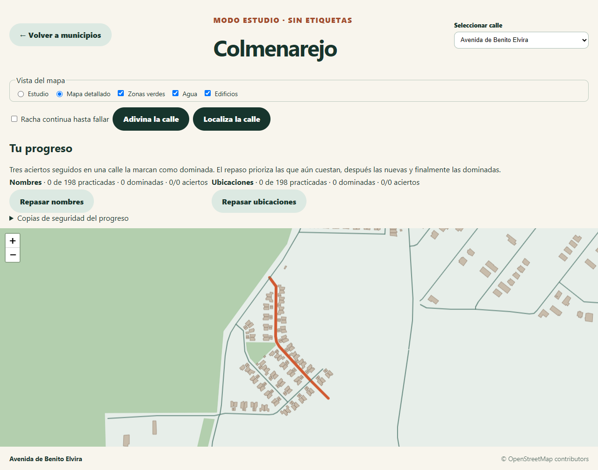
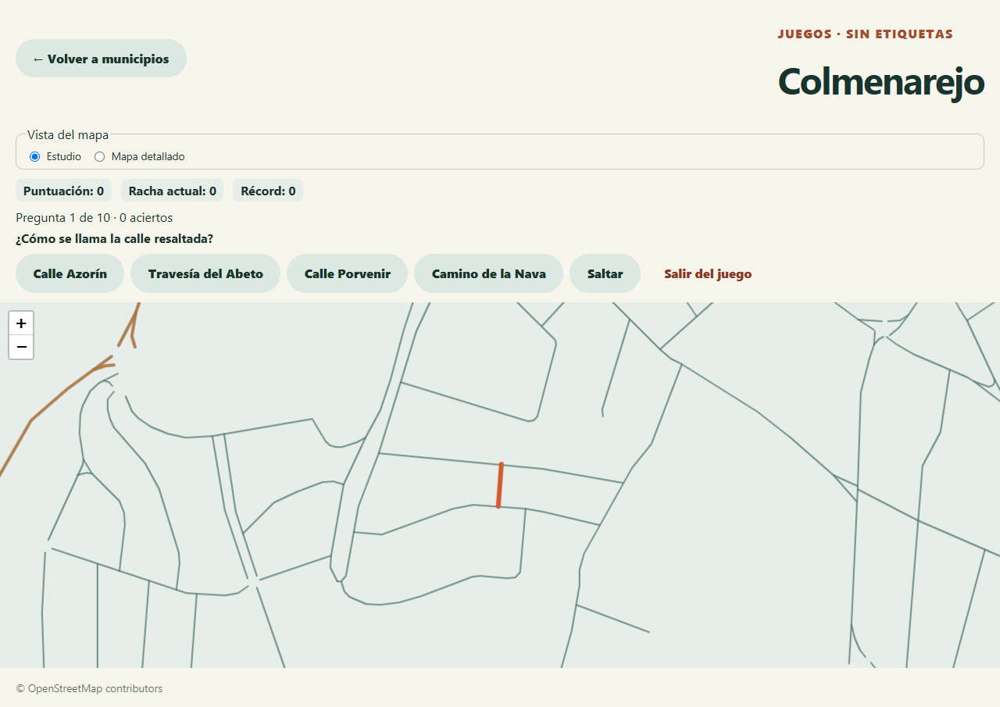

<p align="center">
  
</p>


# StreetQuest

**Descarga el mapa de tu municipio, aprende sus calles y juega sin conexión.**

StreetQuest es una aplicación para Windows con la que puedes estudiar y poner a prueba cuánto conoces las calles de tu ciudad o pueblo. Busca un municipio español, descarga su mapa desde OpenStreetMap una vez y guárdalo en tu equipo. Después podrás explorarlo y jugar sin Internet: el plano no necesita cargar teselas en línea y los juegos ocultan los nombres hasta que respondes.

La aplicación incluye Colmenarejo como mapa de ejemplo para que puedas probarla nada más abrirla. **Puedes buscar y guardar otros municipios desde la propia aplicación**, siempre que OpenStreetMap tenga los datos necesarios y el municipio se ajuste a los límites de descarga actuales.

- [Descargar la aplicación](#descargar-la-aplicación)
- [Empezar con tu municipio](#empezar-con-tu-municipio)
- [Explorar y jugar](#explorar-y-jugar)
- [Mapas sin conexión y copias de seguridad](#mapas-sin-conexión-y-copias-de-seguridad)
- [Alcance y requisitos de los mapas](#alcance-y-requisitos-de-los-mapas)
- [Desarrollo y pruebas](#desarrollo-y-pruebas)
- [Datos y licencias](#datos-y-licencias)

## Descargar la aplicación

1. Descarga el ZIP para **Windows x64** desde [la última versión de StreetQuest](https://github.com/AngelmzDev/StreetQuest/releases/latest).
2. Extrae todo su contenido en una carpeta de tu elección y abre **StreetQuest.exe**. Conserva juntos el ejecutable y el resto de archivos extraídos.
3. Busca tu municipio en la pantalla inicial. Necesitarás Internet para descargar un mapa nuevo; los mapas que ya hayas guardado funcionan sin conexión.

Es una aplicación portable: no necesitas instalar Node.js ni ejecutar un instalador. Los mapas y tu progreso se guardan en el perfil local de Windows y permanecen disponibles cuando cierras la aplicación. La distribución actual no lleva certificado de firma de código. Cada publicación incluye `SHA256SUMS.txt` para verificar la descarga.

## Empezar con tu municipio

1. Conéctate a Internet, escribe el nombre de tu **municipio** y pulsa **Buscar municipio**. La búsqueda actual está orientada a municipios de España.
2. Si aparecen varios resultados, elige el municipio correcto por su nombre y ubicación. Espera a que termine la descarga del límite municipal y sus calles.
3. Abre la nueva tarjeta en **Tus mapas sin conexión**. La app agrupa los tramos que pertenecen a una misma calle para estudiarlos como una unidad.
4. Vuelve a esa tarjeta cuando quieras: el mapa ya está guardado. Puedes descargar otros municipios de la misma manera y cambiar entre ellos desde la pantalla inicial.

Si quieres probar primero la aplicación sin descargar nada, abre el mapa de ejemplo **Colmenarejo** que viene incluido en la versión para Windows. Para practicar con tu propia ciudad o pueblo, sigue los pasos anteriores.

## Explorar y jugar

En el mapa puedes desplazarte, cambiar el zoom y pulsar un tramo para descubrir el nombre de la calle. También puedes escoger una calle de la lista para localizarla. La vista **Estudio** simplifica el plano; **Mapa detallado** permite mostrar edificios, vegetación y agua cuando esos datos están disponibles. Puedes activar o desactivar las capas. Las dos vistas funcionan sin teselas en línea y sin etiquetas que revelen las respuestas.

Elige **Adivina la calle** para identificar un tramo resaltado entre varias respuestas, o **Localiza la calle** para pulsar en el mapa la calle que se te pide. Cada partida corta presenta hasta diez calles distintas, revela la respuesta después de cada intento y muestra tus aciertos al final. Puedes jugar sin conexión con cualquier mapa guardado que tenga suficientes calles.

El marcador suma un punto por acierto. Un fallo o salto reinicia la racha actual. El récord de aciertos seguidos se guarda por municipio y modo de juego. Activa **Racha continua hasta fallar** para seguir jugando sin repetir calles hasta que falles, saltes o agotes el mapa. Al terminar puedes consultar tus errores y practicarlos de nuevo.

**Tu progreso** muestra las calles practicadas, los aciertos y las calles dominadas para nombres y ubicaciones por separado. **Repasar nombres** y **Repasar ubicaciones** priorizan las calles que aún no dominas. Tres aciertos seguidos en una calle la marcan como dominada; un error o salto reinicia esa cuenta. El historial se guarda al responder y permanece al cerrar la aplicación.





*Capturas tomadas con el mapa de ejemplo. El mismo flujo de estudio y juego se aplica a los municipios que descargues.*

## Mapas sin conexión y copias de seguridad

- **Abrir y actualizar:** tus municipios descargados aparecen en **Tus mapas sin conexión**. Puedes abrirlos, actualizar sus datos cuando tengas Internet o eliminar las copias que ya no quieras. Si falla una actualización, se conserva la copia anterior.
- **Llevar un mapa a otro equipo:** usa **Exportar** en la tarjeta del municipio y guarda el archivo JSON. En el otro equipo, elige **Abrir un paquete municipal (.json)**. No hace falta conectarse para importar un paquete ya descargado.
- **Guardar tus resultados:** dentro del mapa, abre **Copias de seguridad del progreso** para exportar o restaurar el historial y los récords de ese municipio. El mapa y el progreso son archivos de copia distintos.

## Alcance y requisitos de los mapas

La búsqueda está orientada a **municipios españoles** con un límite administrativo compatible en OpenStreetMap. El resultado depende de la cobertura de OpenStreetMap: la aplicación necesita un límite válido y suficientes vías con nombre de las categorías seleccionadas. Los municipios demasiado grandes pueden superar los límites de tiempo, tamaño o geometría de la descarga. El detalle de edificios, vegetación y agua también depende de los datos disponibles.

**Internet solo es necesario para buscar, descargar o actualizar un municipio.** Después, el mapa y los juegos se abren desde los datos locales. La búsqueda utiliza servicios públicos que pueden estar ocupados o devolver errores temporales: si ocurre, cancela la operación o vuelve a intentarlo más tarde. Puedes seguir utilizando los mapas guardados y los paquetes JSON que tengas. En la edición web, abre primero la versión compilada con conexión para que el navegador guarde los recursos de la aplicación.

## Desarrollo y pruebas

StreetQuest usa React, TypeScript, Vite y Leaflet. Nominatim busca municipios y Overpass descarga sus límites y vías. El motor recorta los tramos al límite municipal, agrupa calles por nombre y guarda los paquetes en IndexedDB. Electron ejecuta el mismo mapa en Windows desde los recursos locales. La edición web usa un *service worker* para recargar sin conexión.

Para desarrollar o generar el paquete de Windows desde el código necesitas Git, Node.js 22.12 o posterior y pnpm 11. La instalación de dependencias requiere Internet. Las comprobaciones de publicación usan Node.js 24.

```powershell
git clone https://github.com/AngelmzDev/StreetQuest.git
cd StreetQuest
pnpm install --frozen-lockfile
pnpm dev
```

Para generar el ejecutable portable en Windows, ejecuta `pnpm build:windows`. La orden muestra la ruta del ejecutable en `release/`.

| Comando | Qué comprueba o genera |
| --- | --- |
| `pnpm lint` | Reglas de calidad del código |
| `pnpm typecheck` | Tipos de TypeScript |
| `pnpm exec vitest run` | Pruebas unitarias y de integración |
| `pnpm build` | Versión web de producción |
| `pnpm exec playwright test e2e/offline.spec.ts` | Reapertura sin conexión en navegador |
| `pnpm build:windows` | Paquete portable para Windows |

Para probar el ejecutable empaquetado, usa PowerShell y la ruta que imprimió la compilación:

```powershell
$env:STREETQUEST_WINDOWS_EXE = (Resolve-Path 'release/<carpeta-generada>/StreetQuest.exe').Path
pnpm exec playwright test e2e/windows.spec.ts --workers=1
```

La prueba abre el mapa de ejemplo con la red desactivada, selecciona una calle y comprueba que la copia persiste tras reiniciar la aplicación. La descarga desde Nominatim y Overpass se comprueba por separado con `STREETQUEST_LIVE=1` y `e2e/live-import.spec.ts`. Esa prueba depende de la disponibilidad de los servicios externos.

Para usar otros servidores compatibles, copia `.env.example` a `.env.local` y configura `VITE_NOMINATIM_ENDPOINT` y `VITE_OVERPASS_ENDPOINT` antes de compilar. El motor limita las descargas por tiempo, tamaño y cantidad de geometrías. Consulta [la arquitectura](docs/architecture.md) para más detalles.

## Datos y licencias

El código se distribuye bajo la [licencia MIT](LICENSE). El mapa incluido y los datos derivados de OpenStreetMap se distribuyen bajo [ODbL 1.0](https://opendatacommons.org/licenses/odbl/1-0/), con atribución a [© OpenStreetMap contributors](https://www.openstreetmap.org/copyright). La portada es una ilustración inspirada en el juego y los mapas municipales. Consulta [la atribución de datos](ATTRIBUTION.md) para conocer la procedencia del extracto incluido.
